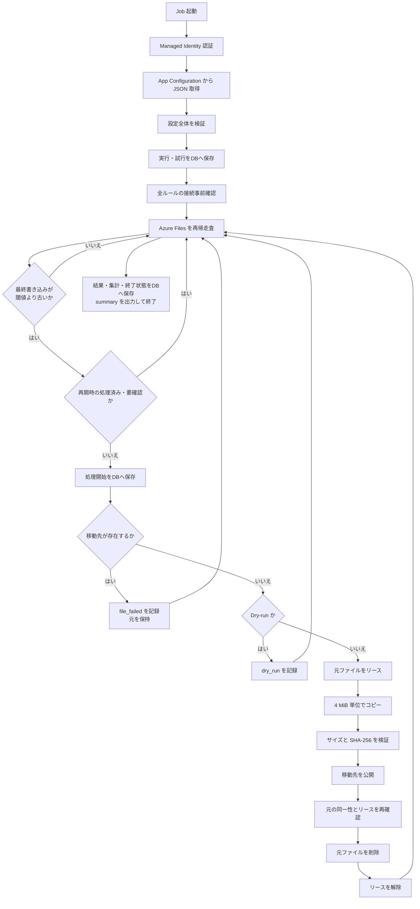

# アプリケーション設計

## 1. 目的

Azure Files の指定パスを走査し、最終書き込みから一定期間が経過したファイルを、
Azure Blob Storage または別の Azure Files 共有へ移動するバッチアプリケーションです。

1回実行して終了するジョブとして、実行履歴とファイル単位の進捗をDBへ保存します。
既定はアプリのローカルSQLiteファイルで、PostgreSQLにも切り替えられます。
CLIで履歴を参照し、実行ID指定で未処理分を再開できます。Web UI、途中コピーの自動復旧は実装しません。
実行結果は引き続き標準出力へJSONログとして記録します。

## 2. 技術構成

| 項目 | 採用技術 |
| --- | --- |
| 実行環境 | Node.js 24 |
| 言語 | TypeScript |
| 設定検証 | Zod |
| 設定ストア | Azure App Configuration |
| ファイル操作 | Azure Storage SDK for JavaScript |
| 認証 | ユーザー割り当て Managed Identity |
| コンテナー | `node:24-bookworm-slim`、非 root ユーザー |
| テスト | Node.js Test Runner、Azure SDK モック |
| 履歴DB | ローカルSQLite (`node:sqlite`)、任意でPostgreSQL (`pg`) |

## 3. モジュール構成

| ファイル | 責務 |
| --- | --- |
| `job/src/index.ts` | 認証、App Configuration 読み込み、タイムアウト、シグナル処理、ジョブ起動 |
| `job/src/config.ts` | 設定 JSON のスキーマ検証、ルール間の競合検証 |
| `job/src/engine.ts` | 走査、対象判定、Dry-run、コピー・検証・削除の制御、集計 |
| `job/src/azure-storage.ts` | Azure Files／Blob の SDK 実装、リース、転送、属性処理 |
| `job/src/model.ts` | ストレージ操作を抽象化するインターフェイスと集計モデル |
| `job/src/check-config.ts` | ローカル設定ファイルの事前検証 |
| `job/src/history.ts` | DB非依存の非同期Repositoryと履歴・進捗モデル |
| `job/src/history-db.ts` | 共通SQLリポジトリ、スキーマ、状態遷移、集計の原子保存 |
| `job/src/history-sqlite.ts` | ローカルSQLiteの接続、トランザクション、所有プロセス確認 |
| `job/src/history-postgres.ts` | PostgreSQLの接続、トランザクション、セッションadvisory lock |
| `job/src/history-config.ts` | DB設定の検証とアダプターファクトリー |
| `job/src/execution.ts` | 論理実行・試行のライフサイクル、保存済み設定による再開 |
| `job/src/cli.ts` | 履歴参照・進捗・再開の引数検証と参照処理 |

ストレージ固有処理は `RuleStorage`、`LockedFile`、`ArchiveWriter` に分離し、
処理エンジンは Azure SDK の詳細に依存しない構成です。
同様に履歴保存を`HistoryRepository`へ分離し、エンジンにDB接続やSQLを持ち込みません。
SQLとスキーマは共通のリポジトリに集約し、パラメーター表記・接続・ロック等のDB差分だけを
小さな内部ドライバーで扱います。将来の保存先はRepository契約を実装して差し替えられます。

## 4. 設定設計

App Configuration の 1 キーに、設定 JSON 全体を保存します。

| 項目 | 既定値 |
| --- | --- |
| キー | `archive:settings` |
| ラベル | `production` |
| コンテンツタイプ | `application/json` |

実行開始時に 1 回だけ取得し、厳密なスキーマ検証後にメモリへ保持します。
実行中に App Configuration を更新しても、反映は次回実行からです。

```json
{
  "version": 1,
  "dryRun": true,
  "maxFilesPerRun": 1000,
  "rules": [
    {
      "id": "documents-to-blob",
      "source": {
        "account": "sourcestorage",
        "share": "documents",
        "path": "completed"
      },
      "destination": {
        "kind": "blob",
        "account": "archivestorage",
        "container": "archive",
        "path": "documents",
        "tier": "Cool"
      },
      "olderThanDays": 90
    }
  ]
}
```

### 設定制約

- `version` は `1` 固定です。
- `dryRun` は省略時 `true` です。
- `maxFilesPerRun` は 1～100,000、既定値は 1,000 です。
- ルールは 1～20 件、記載順に実行します。
- ルール ID は一意の英数字、`_`、`-` に限定します。
- アカウント名、共有名、コンテナー名、相対パスを厳密に検証します。
- `..`、`\`、連続 `/`、末尾のドット／空白など、不明確なパスを拒否します。
- 移動元パス同士、同じ移動先内のパス同士の重複を拒否します。
- Files の移動先共有を、別ルールを含む移動元共有として使用できません。
- Blob の移動先ティアは `Hot`、`Cool`、`Cold` のみです。

## 5. 処理フロー



### 対象判定

- 基準日時はジョブ開始時刻です。
- 判定対象は Azure Files の SMB 最終書き込み時刻 `fileLastWriteOn` です。
- `開始時刻 - olderThanDays × 24 時間` より**前**のファイルを対象にします。
- 閾値と同時刻のファイルは対象外です。
- 空ディレクトリは移動・削除しません。
- `maxFilesPerRun` は候補件数の上限です。Dry-run や失敗も候補件数を消費します。
- 再開は元の設定・基準日時を固定します。各試行の新規候補に上限を適用し、処理済みの除外分は消費しません。

## 6. Dry-run

`dryRun: true` の場合は履歴DBへの書き込みに加えて次の処理のみ行います。

- 全接続先の事前確認
- ファイルの再帰走査
- 最終書き込み時刻による対象判定
- 移動先の存在確認
- `dry_run` ログと集計の出力

リース取得、コピー、属性変更、元ファイル削除は行いません。

## 7. 実移動の安全設計

### 共通

1. 走査時にファイル ID、ETag、サイズ、最終書き込み時刻をバージョン情報として保持します。
2. 元ファイルに無期限リースを取得します。
3. リース取得後に属性を再取得し、走査時から変更されていないことを確認します。
4. 移動先が既に存在する場合は上書きせず、元を保持します。
5. 4 MiB 単位で読み書きし、全ファイルをローカルディスクやメモリへ保持しません。
6. 転送後にサイズと SHA-256 を照合します。
7. 元と移動先の保護状態を再確認してから、元ファイルを削除します。
8. 成否にかかわらずリース解除を試みます。

1 ファイルの上限は 4 MiB × 50,000 ブロック、
**209,715,200,000 バイト（約 195.3 GiB）**です。ファイルは直列処理します。

### Blob への移動

- `If-None-Match: *` で空 Blob を排他的に作成します。
- Blob に無期限リースを取得します。
- 各ブロックに MD5 を付けてアップロードします。
- 検証中は `Hot` で保持し、公開時に設定されたティアへ変更します。
- Content-Type などの HTTP 属性をコピーします。
- 元 URL、作成時刻、最終書き込み時刻、SMB 属性をメタデータへ保存します。
- NTFS ACL は Blob へ適用できないため保持しません。

### Azure Files への移動

- 必要な移動先ディレクトリを作成します。
- 同一親ディレクトリに一意な `.__archive-<UUID>` 一時ディレクトリを排他的に作成します。
- 一時ファイルへ内容をコピーし、無期限リースで保護します。
- 元ファイルの ACL、属性、作成時刻、最終書き込み時刻、HTTP 属性を設定します。
- 検証後、`replaceIfExists: false` で最終パスへ rename します。
- ファイルの ACL は保持しますが、ディレクトリの ACL・属性は複製せず移動先から継承します。

## 8. 競合・障害時の挙動

| 状況 | 挙動 |
| --- | --- |
| 移動先が存在 | 上書きせず `file_failed`、元を保持 |
| 走査後に元が変更 | `changed`、移動しない |
| リース取得失敗 | `file_failed`、元を保持 |
| コピー／検証失敗 | 元を削除せず、移動先とリースを要確認 |
| 上限到達 | `limit_reached`、終了コード 1 |
| 設定・事前接続・走査失敗 | `fatal`、ジョブ中断 |
| 一部ファイルのみ失敗 | 残りのファイル処理を継続 |
| SIGTERM／SIGINT | AbortSignal で中断し、可能な範囲でリース解除 |

コピー後・元削除前に停止したファイルを自動復旧しません。
同じ実行の再開では「要確認」にして除外し、新規実行では移動先の存在を競合として報告します。
強制終了や通信断では無期限リースが残る
可能性があり、ジョブ停止確認後に手動復旧が必要です。

### 履歴・進捗と再開の整合性

- `archive_runs`は論理実行ID、設定スナップショットとハッシュ、固定基準日時、状態を保持します。
- `archive_attempts`は初回・各再開の試行ID、時刻、所有ホスト・PID、集計、終了状態・エラーを保持します。
- `archive_files`はルール・パス・走査時バージョンのハッシュキーで、状態、段階、転送バイト数、結果を保持します。
- `archive_schema`でスキーマバージョンを検査します。未知のバージョンへ上書きしません。
- 処理前に`processing`を保存し、ファイル結果と試行集計を短いDBトランザクションで保存します。
  DB保存失敗はファイル単位で握り潰さず、ジョブ全体を停止します。
- 再開は保存設定を検証して先頭から再走査します。完了済みを再処理せず、失敗・要確認のパスも除外します。
  途中処理は元ファイルが消えていても`needs_review`として残します。
- コピー、検証、公開、削除、後処理の段階を保存します。転送進捗は約1秒ごとと最終ブロックで保存します。
  全体の総件数・完了率は未確定として扱います。
- 同一実行IDの二重再開を拒否します。SQLiteはトランザクション内で所有PIDの生存を確認し、
  PostgreSQLは専用接続のadvisory lockを使います。強制終了後の回復には明示的な`--recover`が必要です。
- DBとAzure Storageの原子性は保証しません。削除後・結果保存前の停止も成功とは推測しません。
- 設定取得以前のエラーはJSONログのみです。保存先を切り替えても履歴の自動移送はしません。

### 履歴DBの物理テーブル設計

SQLiteとPostgreSQLで同じDDLを使います。主キー以外の列にはすべてNOT NULLを指定します。
PostgreSQLの主キーは非NULLですが、SQLiteのTEXT主キーは暗黙の非NULLを保証しないため、
主キー値はアプリ側で必ず生成して渡します。
UUIDは文字列、日時はUTCのISO 8601文字列、詳細レコードはJSON文字列として保存します。
PostgreSQL固有のUUID・TIMESTAMPTZ・JSONB型は使用しません。
設定はアプリ側で検証し、状態値・JSONは型定義に従ってアプリ側で生成します。
DB間の切り替えはRepositoryの背後で行います。

| テーブル | 列 | SQL型 | 制約・用途 |
| --- | --- | --- | --- |
| `archive_runs` | `id` | TEXT | 主キー。論理実行ID |
| `archive_runs` | `created_at` | TEXT | 作成日時 |
| `archive_runs` | `status` | TEXT | 論理実行状態の正本 |
| `archive_runs` | `data` | TEXT | 設定、ハッシュ、基準日時、設定取得元等を含む実行レコードのJSON |
| `archive_attempts` | `id` | TEXT | 主キー。試行ID |
| `archive_attempts` | `run_id` | TEXT | `archive_runs.id`への外部キー |
| `archive_attempts` | `ordinal` | INTEGER | 実行内の試行番号。`(run_id, ordinal)`が一意 |
| `archive_attempts` | `started_at` | TEXT | 試行開始日時 |
| `archive_attempts` | `status` | TEXT | 試行状態 |
| `archive_attempts` | `data` | TEXT | 終了日時、集計、所有者、エラー等を含む試行レコードのJSON |
| `archive_files` | `key` | TEXT | 主キー。実行ID・ルールID・パス・バージョンのSHA-256 |
| `archive_files` | `run_id` | TEXT | `archive_runs.id`への外部キー |
| `archive_files` | `attempt_id` | TEXT | `archive_attempts.id`への外部キー |
| `archive_files` | `path_key` | TEXT | 実行ID・ルールID・パスのSHA-256 |
| `archive_files` | `state` | TEXT | ファイル処理状態 |
| `archive_files` | `data` | TEXT | パス、元バージョン、サイズ、段階、転送バイト数、エラー等のJSON |
| `archive_schema` | `version` | INTEGER | スキーマバージョン。現在は1。1行であることをアプリで検査 |

`data`にはレコード全体を保存するため、一部の列項目も含まれます。
実行状態は`archive_runs.status`を正本として読み取り時に反映します。
試行・ファイルの列値とJSONは同じトランザクションで更新します。
日時・状態値のCHECK制約、JSON内部のDB制約、削除のCASCADE指定はありません。
履歴の削除・DB間の移送機能は含みません。

| インデックス・一意制約 | 対象 | 用途 |
| --- | --- | --- |
| 各テーブルの主キー | `archive_runs.id`、`archive_attempts.id`、`archive_files.key` | ID検索、重複防止 |
| UNIQUE | `archive_attempts(run_id, ordinal)` | 試行順序と実行内の一意性 |
| `archive_file_run` | `archive_files(run_id, key)` | ファイル履歴のページング |
| `archive_file_path` | `archive_files(run_id, path_key, state)` | 再開時の処理済み・要確認の判定 |
| `archive_file_state` | `archive_files(run_id, state)` | 状態別集計、未完了処理の抽出 |

PostgreSQLアダプターの接続時にスキーマバージョンを検査し、未初期化ならこの4テーブルを
トランザクション内で作成します。参照CLIも接続時に初期化するため、初回接続前にこの設計を確認してください。
既存の未知のバージョンは自動変更しません。DDL実装は`job/src/history-db.ts`に集約します。

## 9. ログ・終了コード

標準出力へ 1 行 1 JSON で出力し、全イベントに UTC 時刻と `runId` を付与します。

| 主なイベント | 内容 |
| --- | --- |
| `started` | Dry-run、ルール数、設定キー・ラベル・ETag |
| `attempt_started` | 試行ID、固定基準日時、異常終了回復指定 |
| `dry_run` | 移動候補 |
| `source_lease_acquire` | 元ファイルのリース取得開始 |
| `archive_create` | 移動先作成開始 |
| `moved` | 移動完了 |
| `changed` | 走査後に元が変更された |
| `file_failed` | ファイル単位の失敗 |
| `limit_reached` | 候補件数上限 |
| `summary` | 走査・候補・移動・失敗件数 |
| `fatal` | ジョブ全体を停止するエラー |

正常終了、対象なし、正常な Dry-run は終了コード 0 です。
ファイル失敗、上限到達、致命的エラーは終了コード 1 です。
再開した試行が成功しても、同じ論理実行に失敗・要確認が残る場合は終了コード1です。

## 10. 認証・環境変数

| 環境変数 | 内容 |
| --- | --- |
| `APP_CONFIG_ENDPOINT` | App Configuration の HTTPS endpoint。必須 |
| `APP_CONFIG_KEY` | 既定 `archive:settings` |
| `APP_CONFIG_LABEL` | 既定 `production` |
| `AUTH_MODE` | コンテナーは `managed-identity`、ローカル検証は `azure-cli` |
| `AZURE_CLIENT_ID` | ユーザー割り当て Managed Identity の client ID |
| `JOB_TIMEOUT_SECONDS` | アプリケーション側の実行期限。既定 3,300 秒 |
| `HISTORY_DB_PROVIDER` | `sqlite`（既定）または`postgres` |
| `HISTORY_SQLITE_PATH` | ローカルDBパス。既定`./data/history.sqlite` |
| `HISTORY_POSTGRES_AUTH_MODE` | `password`（既定）または`entra` |
| `HISTORY_POSTGRES_URL` | `password`時のPostgreSQL接続URL。秘密情報として環境変数で注入 |
| `HISTORY_POSTGRES_HOST` | `entra`時のAzureパブリッククラウドPostgreSQLホスト名。ポート5432 |
| `HISTORY_POSTGRES_DATABASE` / `HISTORY_POSTGRES_USER` | `entra`時の接続先DBとDBロール名 |
| `HISTORY_POSTGRES_SCHEMA` | 任意の小文字SQL識別子。Terraformは専用の`archive`を指定 |
| `HISTORY_POSTGRES_TLS` | 既定`verify-full`。ローカル検証のみ`disable` |
| `HISTORY_POSTGRES_CA_PATH` | 任意の検証用CAファイル |

コンテナーでは開発者資格情報や共有キーへフォールバックしません。
PostgreSQLも既定で証明書・ホスト名を検証し、TLS検証の無効化にはフォールバックしません。
DBファイルと台帳にはパス・設定を含むため、アクセス権・バックアップ・容量管理が必要です。
`job/src/auth.ts`で認証の選択を共有し、Entraモードは接続直前にDB用トークンを取得します。
URLとの併用やTLS無効化は拒否し、トークンを履歴・ログへ保存しません。
Terraformの`history_db_provider=postgres`はプライベート接続のFlexible Serverと専用DBを作成します。
管理者が事前にJobのDBロールと`archive`スキーマを用意し、Jobにはそのスキーマ内のDDL/DML権限を与えます。
承認済みの4テーブルの定義は変えません。
SQLiteには永続ボリュームがなく、Container Apps Jobsの実行をまたぐローカルDBの保持は保証しません。
SQLiteをAzure Filesなどの共有へ直接配置する構成は非対応です。

## 11. 対象外

- Web UI
- 履歴画面、自動再開、自動競合解消、途中コピーの自動復旧
- SQLite用のAzure永続ボリューム、DB間のデータ移行
- 複数 execution 間の分散ロック
- NFS Azure Files
- `Microsoft.FileShares` の新しい共有リソース
- Blob Archive ティア
- Blob 上での NTFS ACL 保持
- 空ディレクトリの移動・削除

## 12. テスト方針

- 設定の正常系・異常系
- 閾値境界
- Dry-run の読み取り専用性
- Blob／Files SDK 呼び出し契約
- コピー、検証、公開、削除の順序
- 転送・リース・cleanup の障害
- 空ファイル、複数ブロック、キャンセル
- 移動先競合、走査後変更、上限到達
- SQLite再接続後の永続性、両DBの共通Repository契約、ページング
- DB障害時の安全停止、削除後・結果保存前の不確実性
- 固定設定・日時での再開、各試行の上限、強制終了後の明示的な回復、二重再開の拒否
- SQLite・パスワード認証でAzure接続を要求しない履歴CLI
- Entraトークン取得のタイミングとスコープ、失敗時の停止、接続設定とTLSの検証

PostgreSQL契約テストは`HISTORY_TEST_POSTGRES_URL`指定時に一意のテストスキーマで実行します。
通常のテストは接続先未指定ならPostgreSQLだけスキップします。

Azure SDK はモックし、ユニットテストでは Azure リソースを変更しません。
Managed Identity、RBAC、ネットワーク、SMB ロック、Files rename は専用 Azure 環境で
Dry-run と受け入れ確認を行います。
