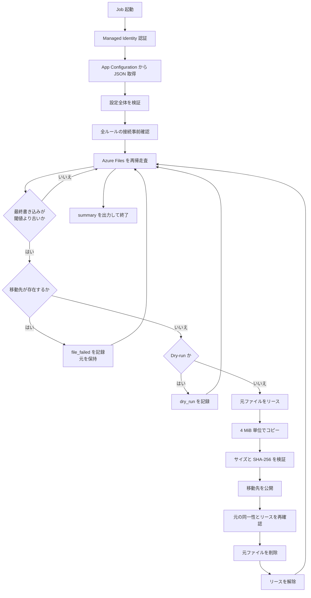
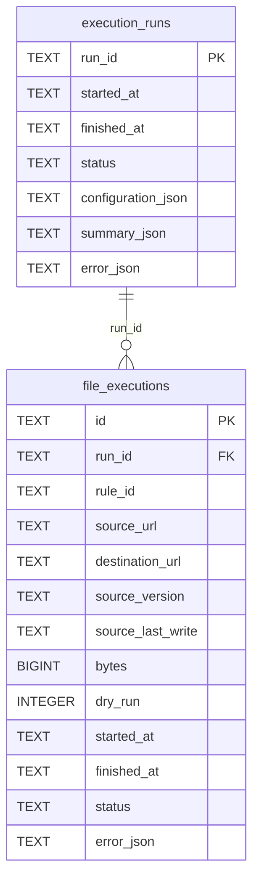

# アプリケーション設計

## 1. 目的

Azure Files の指定パスを走査し、最終書き込みから一定期間が経過したファイルを、
Azure Blob Storage または別の Azure Files 共有へ移動するバッチと、その管理用 Web UI です。

バッチは 1 回実行して終了するジョブです。実行とファイルごとの履歴を Azure では PostgreSQL、
ローカルでは SQLite へ保存し、標準出力にも JSON ログを出力します。
`app/` の Web UI で既存履歴 DB を読み取り専用で参照し、設定・実行を管理します。
自動再開用の進捗台帳は実装しません。詳細は [Web UI](web-ui.md) を参照してください。

## 2. 技術構成

| 項目 | 採用技術 |
| --- | --- |
| 実行環境 | Node.js 24 |
| 言語 | TypeScript |
| Web UI | Node.js 標準 HTTP サーバー、HTML／CSS／JavaScript。Web フレームワーク不使用 |
| 設定検証 | Zod |
| 設定ストア | Azure App Configuration |
| 実行履歴 | PostgreSQL (`pg`)／SQLite (`node:sqlite`) |
| ファイル操作 | Azure Storage SDK for JavaScript |
| 認証 | Azure リソース接続はユーザー割り当て Managed Identity、ローカルは Azure CLI。Web 利用者は組み込み Entra 認証 |
| コンテナー | `node:24-bookworm-slim`、非 root ユーザー |
| テスト | Node.js Test Runner、Azure SDK モック |

## 3. モジュール構成

| ファイル | 責務 |
| --- | --- |
| `job/src/index.ts` | 認証、App Configuration 読み込み、タイムアウト、シグナル処理、ジョブ起動 |
| `job/src/config.ts` | 設定 JSON のスキーマ検証、ルール間の競合検証 |
| `job/src/engine.ts` | 走査、対象判定、Dry-run、コピー・検証・削除の制御、集計 |
| `job/src/azure-storage.ts` | Azure Files／Blob の SDK 実装、リース、転送、属性処理 |
| `job/src/model.ts` | ストレージ操作を抽象化するインターフェイスと集計モデル |
| `job/src/check-config.ts` | ローカル設定ファイルの事前検証 |
| `job/src/history.ts` | PostgreSQL／SQLite の履歴スキーマ、実行とファイル試行の開始・終了記録 |
| `job/src/auth.ts` | バッチと Web UI が共用する Azure CLI／Managed Identity 認証 |
| `app/src/history.ts` | 現行の実行・ファイル履歴テーブルを読み取る Web UI 用アダプター。DB は作成・更新しない |

ストレージ固有処理は `RuleStorage`、`LockedFile`、`ArchiveWriter` に分離し、
処理エンジンは Azure SDK の詳細に依存しない構成です。

## 4. 設定設計

App Configuration の 1 キーに、設定 JSON 全体を保存します。

| 項目 | 既定値 |
| --- | --- |
| キー | `archive:settings` |
| ラベル | `production` |
| コンテンツタイプ | `application/json` |

実行開始時に 1 回だけ取得し、厳密なスキーマ検証後にメモリへ保持します。
実行中に App Configuration を更新しても、反映は次回実行からです。

```json
{
  "version": 1,
  "dryRun": true,
  "maxFilesPerRun": 1000,
  "rules": [
    {
      "id": "documents-to-blob",
      "source": {
        "account": "sourcestorage",
        "share": "documents",
        "path": "completed"
      },
      "destination": {
        "kind": "blob",
        "account": "archivestorage",
        "container": "archive",
        "path": "documents",
        "tier": "Cool"
      },
      "olderThanDays": 90
    }
  ]
}
```

### 設定制約

- `version` は `1` 固定です。
- `dryRun` は省略時 `true` です。
- `maxFilesPerRun` は 1～100,000、既定値は 1,000 です。
- ルールは 1～20 件、記載順に実行します。
- ルール ID は一意の英数字、`_`、`-` に限定します。
- アカウント名、共有名、コンテナー名、相対パスを厳密に検証します。
- `..`、`\`、連続 `/`、末尾のドット／空白など、不明確なパスを拒否します。
- 移動元パス同士、同じ移動先内のパス同士の重複を拒否します。
- Files の移動先共有を、別ルールを含む移動元共有として使用できません。
- Blob の移動先ティアは `Hot`、`Cool`、`Cold` のみです。

## 5. 処理フロー



### 対象判定

- 基準日時はジョブ開始時刻です。
- 判定対象は Azure Files の SMB 最終書き込み時刻 `fileLastWriteOn` です。
- `開始時刻 - olderThanDays × 24 時間` より**前**のファイルを対象にします。
- 閾値と同時刻のファイルは対象外です。
- 空ディレクトリは移動・削除しません。
- `maxFilesPerRun` は候補件数の上限です。Dry-run や失敗も候補件数を消費します。

## 6. Dry-run

`dryRun: true` の場合は次の処理のみ行います。

- 全接続先の事前確認
- ファイルの再帰走査
- 最終書き込み時刻による対象判定
- 移動先の存在確認
- `dry_run` ログと集計の出力

リース取得、コピー、属性変更、元ファイル削除は行いません。

## 7. 実移動の安全設計

### 共通

1. 走査時にファイル ID、ETag、サイズ、最終書き込み時刻をバージョン情報として保持します。
2. 元ファイルに無期限リースを取得します。
3. リース取得後に属性を再取得し、走査時から変更されていないことを確認します。
4. 移動先が既に存在する場合は上書きせず、元を保持します。
5. 4 MiB 単位で読み書きし、全ファイルをローカルディスクやメモリへ保持しません。
6. 転送後にサイズと SHA-256 を照合します。
7. 元と移動先の保護状態を再確認してから、元ファイルを削除します。
8. 成否にかかわらずリース解除を試みます。

1 ファイルの上限は 4 MiB × 50,000 ブロック、
**209,715,200,000 バイト（約 195.3 GiB）**です。ファイルは直列処理します。

### Blob への移動

- `If-None-Match: *` で空 Blob を排他的に作成します。
- Blob に無期限リースを取得します。
- 各ブロックに MD5 を付けてアップロードします。
- 検証中は `Hot` で保持し、公開時に設定されたティアへ変更します。
- Content-Type などの HTTP 属性をコピーします。
- 元 URL、作成時刻、最終書き込み時刻、SMB 属性をメタデータへ保存します。
- NTFS ACL は Blob へ適用できないため保持しません。

### Azure Files への移動

- 必要な移動先ディレクトリを作成します。
- 同一親ディレクトリに一意な `.__archive-<UUID>` 一時ディレクトリを排他的に作成します。
- 一時ファイルへ内容をコピーし、無期限リースで保護します。
- 元ファイルの ACL、属性、作成時刻、最終書き込み時刻、HTTP 属性を設定します。
- 検証後、`replaceIfExists: false` で最終パスへ rename します。
- ファイルの ACL は保持しますが、ディレクトリの ACL・属性は複製せず移動先から継承します。

## 8. 競合・障害時の挙動

| 状況 | 挙動 |
| --- | --- |
| 移動先が存在 | 上書きせず `file_failed`、元を保持 |
| 走査後に元が変更 | `changed`、移動しない |
| リース取得失敗 | `file_failed`、元を保持 |
| コピー／検証失敗 | 元を削除せず、移動先とリースを要確認 |
| 上限到達 | `limit_reached`、終了コード 1 |
| 設定・事前接続・走査失敗 | `fatal`、ジョブ中断 |
| 一部ファイルのみ失敗 | 残りのファイル処理を継続 |
| SIGTERM／SIGINT | AbortSignal で中断し、可能な範囲でリース解除 |
| DB 書き込み失敗 | 後続ファイルを処理せず、`fatal`、終了コード 1 |

履歴は自動再開用台帳ではないため、コピー後・元削除前に停止した処理を自動再開しません。
次回実行では移動先の存在を競合として報告します。強制終了や通信断では無期限リースが残る
可能性があり、ジョブ停止確認後に手動復旧が必要です。

## 9. ログ・終了コード

標準出力へ 1 行 1 JSON で出力し、全イベントに UTC 時刻と `runId` を付与します。

| 主なイベント | 内容 |
| --- | --- |
| `started` | Dry-run、ルール数、設定キー・ラベル・ETag |
| `dry_run` | 移動候補 |
| `source_lease_acquire` | 元ファイルのリース取得開始 |
| `archive_create` | 移動先作成開始 |
| `moved` | 移動完了 |
| `changed` | 走査後に元が変更された |
| `file_failed` | ファイル単位の失敗 |
| `limit_reached` | 候補件数上限 |
| `summary` | 走査・候補・移動・失敗件数 |
| `fatal` | ジョブ全体を停止するエラー |

正常終了、対象なし、正常な Dry-run は終了コード 0 です。
ファイル失敗、上限到達、致命的エラーは終了コード 1 です。

### DB 設計

#### 保存先と初期化

Azure では PostgreSQL の `executionlog` データベース、ローカルでは SQLite の
永続ファイルを使用します。`job/src/history.ts` の共通 SQL で、起動時に
`CREATE TABLE IF NOT EXISTS`／`CREATE INDEX IF NOT EXISTS` を実行します。
既存テーブルの列変更を扱うマイグレーション機構はありません。

時刻は UTC の ISO 8601 文字列、JSON は `JSON.stringify` による文字列として
`TEXT` に保存します。PostgreSQL 固有の `TIMESTAMPTZ`／`JSONB` は使用しません。
ID はアプリケーション側で生成する UUID 文字列です。

#### テーブルの関連



#### `execution_runs`：実行単位の履歴

1 回のジョブ実行につき 1 行を保存します。

| 列 | SQL 型 | NULL | 内容・制約 |
| --- | --- | --- | --- |
| `run_id` | `TEXT` | 不可 | 主キー。標準出力の `runId` と同じ UUID |
| `started_at` | `TEXT` | 不可 | DB への実行開始記録時刻 |
| `finished_at` | `TEXT` | 可 | 結果記録時刻。開始時は NULL |
| `status` | `TEXT` | 不可 | CHECK：`running`／`succeeded`／`failed`／`limit_reached` |
| `configuration_json` | `TEXT` | 可 | Dry-run、ルール数、設定キー・ラベル・ETag。設定取得前は NULL |
| `summary_json` | `TEXT` | 可 | `scanned`、`eligible`、`moved`、`dryRun`、`changed`、`failed`、`limitReached` |
| `error_json` | `TEXT` | 可 | 致命的エラーの詳細。正常時は NULL |

`configuration_json` は設定 JSON 全体のコピーではなく、
`dryRun`、`ruleCount`、`configurationEtag`、`configurationKey`、
`configurationLabel` のメタ情報です。
通常の集計終了では `summary_json` を保存し、致命的エラーで中断した場合は
`error_json` を保存します。この中断経路では途中集計を保存しません。
ファイル単位の失敗だけで実行が `failed` になった場合、実行の `error_json` は NULL です。

#### `file_executions`：候補ファイルの処理試行

対象期間に該当し、処理上限内にある候補について、1 回の試行につき 1 行を保存します。
対象外ファイルや、上限到達後の未処理候補は個別保存しません。

| 列 | SQL 型 | NULL | 内容・制約 |
| --- | --- | --- | --- |
| `id` | `TEXT` | 不可 | 主キー。試行ごとの UUID |
| `run_id` | `TEXT` | 不可 | 外部キー：`execution_runs.run_id` |
| `rule_id` | `TEXT` | 不可 | App Configuration のルール ID |
| `source_url` | `TEXT` | 不可 | 移動元 Files の HTTPS URL。パスを URL エンコード |
| `destination_url` | `TEXT` | 不可 | 移動先 Blob／Files の最終パスの HTTPS URL |
| `source_version` | `TEXT` | 不可 | 走査時の同一性判定用バージョン情報 |
| `source_last_write` | `TEXT` | 不可 | 走査時の SMB 最終書き込み時刻 |
| `bytes` | `BIGINT` | 不可 | 走査時のファイルサイズ（バイト） |
| `dry_run` | `INTEGER` | 不可 | CHECK：`0`＝実移動、`1`＝Dry-run |
| `started_at` | `TEXT` | 不可 | 候補の処理開始記録時刻 |
| `finished_at` | `TEXT` | 可 | 処理結果記録時刻。開始時は NULL |
| `status` | `TEXT` | 不可 | CHECK：`running`／`moved`／`changed`／`dry_run`／`failed` |
| `error_json` | `TEXT` | 可 | ファイル処理エラーの詳細。正常時は NULL |

`error_json` はエラー名・メッセージ・取得可能なコードを保持し、
複合エラーでは `causes` に内訳を保存します。ファイル内容や認証トークンは保存しません。
SHA-256 は転送検証に使いますが、履歴テーブルには保存しません。

#### 状態遷移と記録タイミング

| 対象 | 遷移 | 条件 |
| --- | --- | --- |
| 実行 | `running` → `succeeded` | ファイル失敗・上限到達なし。対象なしや正常な Dry-run を含む |
| 実行 | `running` → `failed` | ファイル失敗あり、または致命的エラーで中断 |
| 実行 | `running` → `limit_reached` | ファイル失敗なしで候補件数上限に到達 |
| ファイル | `running` → `moved` | コピー・検証・公開・元削除・リース後処理が完了 |
| ファイル | `running` → `changed` | リース取得後に元の変更などを検出し、移動を見送り |
| ファイル | `running` → `dry_run` | サイズ・移動先存在確認を通過し、操作を見送り |
| ファイル | `running` → `failed` | 移動先競合、サイズ超過、コピー・検証・リース後処理などの失敗 |

DB 初期化後、App Configuration の取得前に実行開始を記録します。
設定の取得・検証後にメタ情報を更新し、ファイル操作前に試行開始をコミットします。
操作とリース後処理の完了後にファイル結果をコミットし、最後に実行結果を記録します。
各 SQL は自動コミットで実行し、ジョブ全体やファイル操作を囲む DB トランザクションはありません。

標準出力のファイル結果イベントは DB の結果保存より先に出力されるため、
ログに `moved` があっても DB の結果更新が成功したとは限りません。
起動時の環境変数検証や DB 初期化・実行開始保存に失敗した場合、実行行が残らないこともあります。

#### 索引・整合性・運用上の制約

| 索引 | 対象 | 用途 |
| --- | --- | --- |
| 主キー | `execution_runs.run_id` | 実行 ID による特定 |
| 主キー | `file_executions.id` | ファイル試行の結果更新 |
| `file_executions_run_id` | `file_executions.run_id` | 実行単位のファイル照会 |
| `execution_runs_started_at` | `execution_runs.started_at` | 開始時刻による履歴照会 |

外部キーに削除カスケードは設定しません。同じファイルの再実行は別の試行行として保存し、
移動元 URL に一意制約は設けません。自動再開・重複排除・分散排他には使用しません。
履歴の自動削除や保存期間設定も未実装です。削除する場合は関連するファイル履歴から
先に削除する運用が必要です。

Storage と DB は分散トランザクションにしません。強制終了や結果保存失敗では
`running` が残るため、元・移動先・リースを手動確認します。
リース後処理の失敗は元削除後にも発生し得るため、`failed` は元ファイルの存在を保証しません。
DB の保存失敗はストレージ操作の失敗として処理せず、ジョブ全体へ伝播させ、
後続ファイルの移動を停止します。

#### 接続・永続化

PostgreSQL は Entra トークンをパスワードとして使用し、TLS 1.2 以上で
サーバー証明書を検証します。接続プールは最大 1 接続、接続タイムアウトは 10 秒、
クエリタイムアウトは 15 秒、サーバー側 statement timeout は 10 秒です。
Azure の設計上の接続経路は Private Endpoint です。
管理者は `postgres` で Entra ロールを作成し、`executionlog` に切り替えて権限を付与します。
Job は非管理者の専用ロールでテーブル・索引を作成します。
`PGUSER` は DB に登録した Entra ロール名を指定し、メールアドレスと一致するとは限りません。

SQLite は `AUTH_MODE=azure-cli` のローカル実行だけで使用できます。
WAL、`synchronous=FULL`、外部キー検証、5 秒の busy timeout を設定します。
`:memory:`、空パス、`file:` URL は拒否し、履歴を永続ファイルへ保存します。
`DB_DRIVER=sqlite|postgres` による切り替えは環境変数で行います。

#### 履歴の照会例

PostgreSQL では `executionlog` に接続して実行します。
以下の基本 SQL は SQLite でも共通です。

```sql
SELECT run_id, started_at, finished_at, status, summary_json, error_json
FROM execution_runs
ORDER BY started_at DESC
LIMIT 20;

SELECT rule_id, source_url, destination_url, bytes, dry_run, status, error_json
FROM file_executions
WHERE run_id = '<確認対象の run_id>'
ORDER BY started_at;

SELECT run_id, status, COUNT(*) AS file_count, SUM(bytes) AS total_bytes
FROM file_executions
GROUP BY run_id, status;
```

設定と運用手順は [実行履歴 DB](../job/README.md#実行履歴-db)、
初期ロール作成は [インフラストラクチャのデプロイ手順](../infra/README.md) を参照してください。

## 10. 認証・環境変数

| 環境変数 | 内容 |
| --- | --- |
| `APP_CONFIG_ENDPOINT` | App Configuration の HTTPS endpoint。必須 |
| `APP_CONFIG_KEY` | 既定 `archive:settings` |
| `APP_CONFIG_LABEL` | 既定 `production` |
| `AUTH_MODE` | コンテナーは `managed-identity`、ローカル検証は `azure-cli` |
| `AZURE_CLIENT_ID` | ユーザー割り当て Managed Identity の client ID |
| `JOB_TIMEOUT_SECONDS` | アプリケーション側の実行期限。既定 3,300 秒 |
| `DB_DRIVER` | Azure は `postgres`、ローカルは `sqlite` が既定 |
| `PGHOST` / `PGDATABASE` / `PGUSER` | PostgreSQL ホスト、DB、Entra DB ロール |
| `SQLITE_PATH` | ローカル SQLite の永続ファイルパス。既定 `execution-log.sqlite` |

コンテナーでは開発者資格情報や共有キーへフォールバックしません。
この表はバッチ用です。Web の `WEB_*`、`PORT` と DB 接続の違いは
[Web UI の環境変数](web-ui.md#環境変数)を参照してください。

## 11. Web UI の設計

Web は継続稼働し、バッチとは別プロセス・別の Managed Identity を使用します。

| 操作 | 実装・保存先 |
| --- | --- |
| 実行・ファイル履歴の参照 | 既存 `execution_runs`／`file_executions`。読み取り専用、スキーマ作成・変更なし |
| アーカイブ設定の保存 | バッチ共通スキーマで検証し、App Configuration に ETag 付きで保存 |
| スケジュール設定 | 対象 Job の Manual／Schedule を ARM API で更新。毎日・毎週の JST を UTC cron に変換 |
| 単発起動 | 保存済み設定の ETag と実行モードを確認し、Job の標準テンプレートを 1 回起動 |

Web の DB ロールは SELECT のみに限定し、Storage データアクセス権は付与しません。
履歴の `running` と Azure の execution 状態は別に扱い、Web から結果を書き換えません。
起動要求の重複抑止は同一 Web プロセス内だけで、永続台帳や分散ロックではありません。
組み込み Entra 認証に加えて発行者・テナント・許可ユーザー、Host・Origin を検査します。
API、モジュール構成、更新競合・起動結果不明時の操作は [Web UI の解説](web-ui.md) を参照してください。

## 12. 対象外

- 自動再開用の進捗台帳、試行・再開の専用履歴画面
- 自動再開、自動競合解消
- 複数 execution 間の分散ロック
- NFS Azure Files
- `Microsoft.FileShares` の新しい共有リソース
- Blob Archive ティア
- Blob 上での NTFS ACL 保持
- 空ディレクトリの移動・削除

## 13. テスト方針

- 設定の正常系・異常系
- 閾値境界
- Dry-run の読み取り専用性
- Blob／Files SDK 呼び出し契約
- コピー、検証、公開、削除の順序
- 転送・リース・cleanup の障害
- 空ファイル、複数ブロック、キャンセル
- 移動先競合、走査後変更、上限到達
- SQLite の永続化、PostgreSQL の共通 SQL、DB 障害時の移動停止
- Web による現行履歴 DB の読み取り専用参照、未記録値・不正スキーマの扱い
- 設定保存の ETag、認証・CSRF 検査、スケジュール変換・更新、単発起動と重複抑止

Azure SDK はモックし、ユニットテストでは Azure リソースを変更しません。
Managed Identity、RBAC、ネットワーク、SMB ロック、Files rename は専用 Azure 環境で
Dry-run と受け入れ確認を行います。
2026-11-20 の専用環境では Entra サインイン、Web の読み書き、単発 Dry-run と
PostgreSQL／Storage のプライベート接続を確認しました。
実コピー・削除や有効な定期スケジュールの発火は、この確認実績には含みません。

